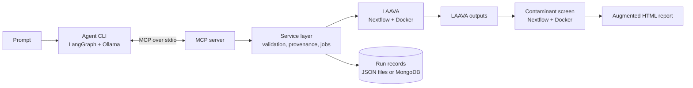

# aav-agent

A local AI agent that runs [LAAVA](https://github.com/formbio/laava) on PacBio long-read data from AAV vector preps, then identifies what the unmapped reads actually are.

LAAVA classifies reads as vector, packaging plasmid, host or chimeric, and counts everything else as unmapped. It does not say what that "everything else" is. For gene-therapy quality control that matters, because residual DNA from other sources (plasmid-production bacteria, insect cells, plants, other contaminants) is something regulators ask about. This project adds that step, and lets you drive the whole workflow in plain language:

> *Run LAAVA on the ss spike-in fastq with the ss construct and its annotation BED, using the packaging and human genome (hg38) host files in laava/test, and screen the contaminants.*

The agent finds the files, runs LAAVA, BLASTs the unmapped reads, classifies them by organism type, and adds a pie chart section to the LAAVA HTML report. LAAVA itself is used unmodified.

> **Status:** a working prototype and portfolio project. Research use only; it has not been validated for regulated (GxP/FDA) use. See [Limitations](#limitations).

---

## What you get

For a finished LAAVA run, a copy of the LAAVA report with a new **Contaminant screening** section (inserted before "Methods"):

* a pie chart of the unmapped reads by organism type,
* a table of reads and bases per type, and of the taxa identified,
* the database actually used (title and build date, read from BLAST itself, never typed by hand),
* warnings when the inputs look mismatched.

Example, from the demonstration data (a real LAAVA test sample with 100+ synthetic contaminant reads spiked in):

```
LAAVA run 20261016-231028-492d7e (sample mcp.test): 3,627 reads, 130 unmapped (3.6%).
  By reference: vector 3,414; (unmapped) 130; chimeric-vector 30; repcap 27; host 13; helper 8; chimeric-nonvector 5
Contaminant screen screen-001 against AAV demo contaminants, Oct 7, 2026: 130 unmapped reads classified.
  soil bacteria: 50 (38.5%)
  insect: 24 (18.5%)
  enterobacteria: 22 (16.9%)
  no hit: 14 (10.8%)
  plant: 10 (7.7%)
  baculovirus: 10 (7.7%)
Report with contaminant section: data/runs/.../mcp.test_AAV_report.contaminants.html
```

On the spiked data, 109 of 110 synthetic reads land in the right category. The miss is a read with no BLAST hit at all, probably low-complexity masking (not confirmed). The 20 unmapped reads that were in the real sample resolve to *E. coli* (7) and no hit against the demo database (13, which are expected to be human; the demo database contains no human sequence).

---

## How it works



| Layer | What it does | Where |
|---|---|---|
| Bioinformatics tools | extract unmapped reads, BLAST, taxonomic classification (LCA), report splice, synthetic spike-in generator | `src/aav_agent/tools/`, `scripts/` |
| Screening workflow | Nextflow pipeline, one container image for the steps | `pipeline/`, `docker/` |
| Service layer | the tool functions: validate inputs, run LAAVA and the screen in the background, record provenance | `src/aav_agent/service.py` and friends |
| MCP server | exposes the service as MCP tools over stdio | `src/aav_agent/mcp_server/` |
| Agent | LangGraph graph around a local LLM; calls the MCP tools | `src/aav_agent/agent/` |

The language model only interprets the request and chooses tools. The bioinformatics is deterministic code. Each layer works and is tested without the one above it, so you can run the pipeline by hand, drive it from the MCP inspector, or talk to the agent.

### The classification, briefly

Reads LAAVA labels `(unmapped)` are BLASTed (megablast). For each read the hits are scored per subject sequence, all subjects within 2% of the best are kept, and the lowest common ancestor of their taxa is taken. That LCA is mapped to a category by an ordered list of NCBI taxonomy nodes in [`scripts/categories.yaml`](scripts/categories.yaml). Reads whose best hits span unrelated organisms are `ambiguous`; reads split between two categories are `mixed`; reads with no significant hit are `no hit`. A "no hit" read is not evidence of absence: it may be low-complexity sequence or an organism the database does not contain.

### The agent's design

Choices made because the model is small (developed against `qwen3:8b` on Ollama):

* **Polling is hidden.** `run_laava` and `screen_contaminants` start background jobs and return at once; the agent itself waits on them, so the model never has to run a polling loop.
* **Numbers are not left to the model.** After the model's reply, the answer gets a results block built directly from the tool output (read counts, buckets, report path).
* **Errors are data.** Bad input comes back as a readable message the model can act on, not an exception. Arguments a tool does not have are rejected before the call.
* **Files are chosen by content.** `list_input_files` ranks files by the user's own words and describes each one ("FASTA, 2 records (chr19, chrM), 24.6 Mb; looks like a genome, so a candidate host genome; the file name suggests human"). `describe_input` reads record and feature names out of FASTA and BED files, so names are never guessed.
* **Inputs are validated before anything runs**: file paths must lie under allowed folders (symlinks cannot escape them); `repcap_name`, `helper_name` and `lambda_name` must name records in the packaging FASTA; ITR labels must be feature names in the annotation BED; the BED must describe the vector FASTA. After a run, heuristics warn when most reads are `other-vector` or unmapped, or carry raw record names, which usually means the reads, construct and annotation do not belong together.
* **Provenance** is recorded per run: input checksums, LAAVA git commit and dirty flag, container image IDs and digests, Nextflow version, BLAST version, and the database title, date and sequence count.

---

## Requirements

* Python 3.11+ and [Poetry](https://python-poetry.org/)
* Docker (the LAAVA image and this project's tools image run in containers)
* [Nextflow](https://www.nextflow.io/) (needs Java)
* A checkout of [formbio/laava](https://github.com/formbio/laava) next to this repo
* [Ollama](https://ollama.com/) reachable from the machine running the agent, with a tool-capable model (`qwen3:8b` tested). It can run locally or on another machine; larger or cloud models are more reliable, see [Choosing a model](#choosing-a-model)
* Optional: MongoDB for run records (otherwise a folder of JSON files is used); BLAST+ only if you run `scripts/` outside Docker

Developed on macOS (Intel) with Ollama on a separate Windows GPU machine. On Windows, run everything except Ollama inside WSL2.

---

## Setup

```bash
# 1. layout: this repo and LAAVA are siblings
projects/
├── aav_agent/      # this repo
└── laava/          # git clone https://github.com/formbio/laava

# 2. Python environment
cd aav_agent
poetry install

# 3. the tools image used by the screening workflow
docker build -f docker/tools.Dockerfile -t aav-agent-tools:local .

# 4. the demo contaminant database and the NCBI taxonomy
scripts/build_demo_db.sh --download-taxdump        # needs BLAST+ (or run inside the image)

# 5. settings
cp config/settings.example.yaml config/settings.yaml   # then edit the paths
```

`config/settings.yaml` says where the runs go, where LAAVA is, which BLAST databases exist, and which folders the tools may read:

```yaml
data_dir: ../data
laava_dir: ../../laava
screen_pipeline: ../pipeline/contaminant_screen.nf
taxdump_dir: ../data/taxonomy
categories: ../scripts/categories.yaml
allowed_input_roots: [../data, ../../laava, ../fixtures]
default_database: demo
databases:
  demo: {dir: ../data/blastdb, db_name: demo_contaminants, description: Small demo contaminant database}
  # nt: {dir: /mnt/ncbi/blast, db_name: core_nt, description: NCBI core_nt}
nxf_syntax_parser: v1        # LAAVA's nextflow.config needs the older parser on recent Nextflow
```

To use a full NCBI database instead of the demo one, add it under `databases` and pass its name. The code never loads NT into the repo; databases are mounted from elsewhere.

### Environment variables

| Variable | Used for |
|---|---|
| `OLLAMA_HOST` | where the agent finds Ollama, e.g. `http://192.168.1.20:11434` |
| `OLLAMA_API_KEY` | only for Ollama's cloud; sent only to ollama.com |
| `AAV_LLM_MODEL` | model name (default `qwen3:8b`) |
| `AAV_SETTINGS` | path to `settings.yaml` (or pass `--settings`) |
| `AAV_MONGO_URI`, `AAV_MONGO_DB` | use MongoDB for run records |

---

## Usage

### 1. Talk to the agent

```bash
export OLLAMA_HOST=http://localhost:11434
poetry run python -m aav_agent.agent --settings $PWD/config/settings.yaml -v \
  --transcript data/agent_transcripts/session.jsonl \
  "Run LAAVA on the ss spike-in fastq with the ss construct and its annotation BED, using the packaging and human genome (hg38) host files in laava/test, and screen the contaminants."
```

Progress goes to stderr, the answer to stdout. `-v` also prints every tool result; `--transcript` appends every prompt, call and result to a JSON-lines file, which is the first thing to read when the model does something odd. Without a prompt you get an interactive session that remembers earlier answers (so "now screen it against core_nt" works).

### 2. Use the tools without a model (MCP inspector)

```bash
npx @modelcontextprotocol/inspector -- \
  poetry run python -m aav_agent.mcp_server --settings $PWD/config/settings.yaml
```

Tools: `list_databases`, `list_input_files`, `describe_input`, `run_laava`, `screen_contaminants`, `wait_for_job`, `get_run`, `list_runs`. A typical session is `list_input_files`, `run_laava`, `wait_for_job` until it succeeds, `screen_contaminants`, `wait_for_job` with the `screen_id`.

### 3. Run the pieces by hand

```bash
# LAAVA (its own Nextflow workflow), writing outside the LAAVA checkout
(cd ../laava && NXF_SYNTAX_PARSER=v1 nextflow run -profile local main.nf \
   -params-file /abs/path/params.json --output /abs/path/data/laava/output -w /abs/path/data/laava/work \
   --cpus 4 --memory '6 GB' --container_version :latest)

# the contaminant screen on that output
nextflow run pipeline/contaminant_screen.nf -profile local \
  --laava_output data/laava/output --sample_id ss.spikein \
  --blast_db_dir data/blastdb --blast_db_name demo_contaminants \
  --taxdump_dir data/taxonomy --outdir data/screen
```

### Demonstration data

`fixtures/contaminants/` holds small FASTA files (soil bacteria, an insect, a baculovirus, *E. coli*, a plant organelle genome) used to build the demo database. `src/aav_agent/tools/spike_in.py` adds synthetic contaminant reads from them to real LAAVA test reads and writes a truth table, so the screen can be checked against known answers:

```bash
python -m aav_agent.tools.spike_in reads.bam fixtures/spike_in/spike.yaml out.fastq.gz out.truth.tsv --seed 42
```

The synthetic reads validate the logic and plumbing. They do not reproduce real PacBio artifacts such as chimeras or incomplete consensus reads.

---

## Tests

```bash
poetry run pytest                                    # unit tests: no Docker, Nextflow, Ollama or Mongo needed
AAV_INTEGRATION=1 AAV_SETTINGS=config/settings.yaml \
  poetry run pytest -m integration -s                # real LAAVA and screen (slow)
```

The unit tests run the service layer against a fake command runner that copies real LAAVA output (a per-read table, a trimmed real report), so format changes in LAAVA show up without Docker. The agent is tested with a scripted fake model and a fake MCP client. The integration test runs the real thing on the spike-in data.

---

## Repository layout

```
src/aav_agent/
├── agent/          LangGraph graph, prompt, Ollama and MCP clients, CLI
├── mcp_server/     MCP server (stdio)
├── lims/           run and screen records: JSON files, MongoDB
├── tools/          extract_unmapped, classify_reads, add_contaminants_to_report, spike_in
├── service.py      the tool functions (validation, background jobs, provenance)
├── spec.py         the run specification and its validation
├── inputs.py       reading FASTA/BED files, file descriptions
├── provenance.py   code, image and tool versions
├── config.py       settings and the allowed-folders check
└── runner.py       running external commands (replaceable in tests)
pipeline/           Nextflow contaminant-screen workflow
docker/             tools image (BLAST+, Python deps)
scripts/            build_demo_db.sh, run_blastn.sh, categories.yaml, make_report_skeleton.py
config/             settings examples
fixtures/           demo contaminant FASTA files, spike-in reads and truth table
tests/              unit tests, golden LAAVA outputs, opt-in integration test
data/               runs, BLAST databases, taxonomy (git-ignored)
```

Each run lives in `data/runs/<run_id>/`: `params.json`, `spec.json`, `logs/`, `output/` (LAAVA), and `screens/screen-NNN/` for each contaminant screen. A run can be re-screened against a different database without re-running LAAVA.

---

## Choosing a model

Tool calling worked reliably with `qwen3:8b` on an 8 GB GPU, but following long multi-part requests did not: it ignored parts of prompts, invented file names, and filled optional arguments with plausible values. Most of the tool design above exists because of that. Options, in rough order of effort:

* a larger model through Ollama (`--model`, `OLLAMA_HOST`),
* Ollama's cloud models: set `OLLAMA_API_KEY` and use `--ollama-host https://ollama.com` with a cloud model name,
* another provider, by writing an adapter with the same `chat(messages, tools)` interface as `agent/llm.py`.

With a cloud model, the prompt and tool results leave your machine: file paths, record and feature names, run ids, read counts and taxon buckets (not sequence reads). Check your data policy first.

---

## Troubleshooting

| Symptom | Cause and fix |
|---|---|
| Docker build killed with exit code 137 | Docker ran out of memory; give the VM more (8 GB is comfortable) |
| `Variable declarations cannot be mixed with config statements` | LAAVA's `nextflow.config` needs the older parser: `NXF_SYNTAX_PARSER=v1` (or `nxf_syntax_parser: v1` in settings) |
| `No such variable: sample_id` in a pipeline script | strict-syntax parser: use closures for dynamic `tag`/`publishDir` (already done in `pipeline/`) |
| MCP inspector shows the server as disconnected and asks for the settings path | launchers forward only a few environment variables; pass `--settings` as an argument, or use the inspector's `-e KEY=VALUE` |
| `No module named aav_agent...` | the project is not installed in the active environment: `poetry install`, or `pip install -e .` |
| `poetry add mcp` fails looking for OpenSSL | on Intel Macs `cryptography` has no wheel and builds from source: `brew install openssl@3 rust`, then `export OPENSSL_DIR="$(brew --prefix openssl@3)"` |
| `cannot import name FastMCP` | MCP SDK v2 renamed it to `MCPServer`; the server tries both |
| Agent cannot reach Ollama on another machine | on the Ollama machine set `OLLAMA_HOST=0.0.0.0`, restart it, allow TCP 11434 through the firewall; test with `curl $OLLAMA_HOST/api/tags` |
| LAAVA reports everything as `other-vector` | the reads do not belong to the construct and annotation supplied; the run warns about this |

---

## Limitations

* **Not validated for regulated use.** No qualification, audit trail or access control beyond the run records.
* **The demo database is small** and has no human sequence, so human reads come back as "no hit". Use a full database (`core_nt`) for real work.
* **Packaging references are handled one record per name.** Several FASTA files for helper, RepCap and lambda that must be concatenated, and RepCap split over several plasmids sharing one type, are not supported yet. Packaging records without a type (for example `E1A_E1B`, `Fiber`) keep their own names as labels, and the run warns when reads map to them.
* **Chimeric reads are not analysed.** Telling expected chimeras (a payload with human sequence) from unexpected ones needs LAAVA's alignment segments, which it does not report; this is the next bioinformatics feature.
* **One server process per run store, one job at a time.**
* **Heuristics, not truth.** The "other-vector" and unmapped thresholds, and the species hints taken from file names, are rules of thumb. The `mitr_label` check (refused for single-stranded vectors) rests on my reading of LAAVA; remove it if LAAVA uses the label there.
* **A small local model is the weak link.** See [Choosing a model](#choosing-a-model).

---

## Roadmap

* a tool that proposes a complete input set (reads, vector, annotation, packaging, host) for the model to confirm, and a catalog of lab reference sets
* reference sets: concatenating several FASTA files and assigning several record names to one type
* chimera analysis from LAAVA's alignments, with a map of sequence shared between vector and helper plasmids
* an evaluation set of prompts with checkable outcomes, to compare models objectively
* PDF output; AWS Batch execution (the paths and storage are already URI-friendly, the Batch profile is an untested sketch)

---

## Acknowledgements and licensing

* [LAAVA](https://github.com/formbio/laava) by Form Bio is used unmodified, through its own Nextflow workflow and published image. Test reads come from PacBio's public AAV example datasets, via LAAVA's test samples. Check the licenses and data terms of both before redistributing anything derived from them.
* NCBI BLAST+ and the NCBI taxonomy; the Model Context Protocol SDK; LangGraph; Ollama.
* This repository contains only code, public or simulated data, and small fixtures. It contains no data from any employer or collaborator.

**License:** TODO (choose one before publishing).
